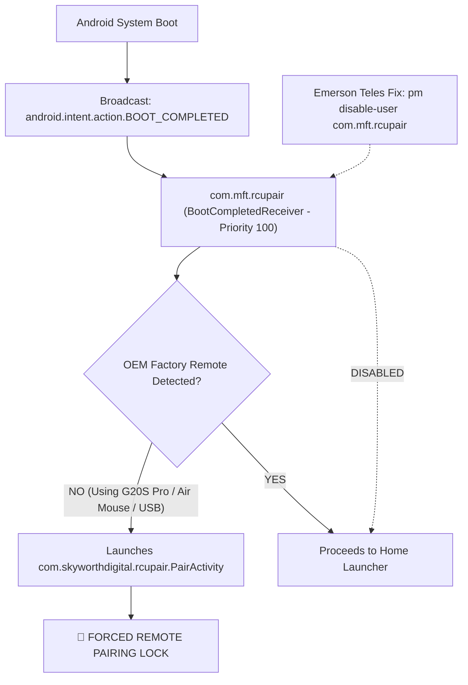

# 📺 Android TV Remote Pairing Fix — Ultimate Bypass and Fix Utility

<p align="center">
  <a href="README.md">🇧🇷 Português</a> | <b>🇺🇸 English</b>
</p>

<p align="center">
  <a href="https://github.com/Emertels/AndroidTV-Remote-Pairing-Fix/releases"></a>
  <a href="https://android.com"></a>
  <a href="https://microsoft.com/windows"></a>
  
  <a href="LICENSE"></a>
</p>

A lightweight, intelligent portable utility developed by **Emerson Teles** (with technical assistance from **Gemini**) to permanently solve the chronic boot-lock issue caused by forced OEM remote pairing screens (`com.mft.rcupair`) and provide complete system debloating and optimization for TV Sticks and TV Boxes (Mecool, Mibro, Skyworth, and compatible hardware running Android 11, 12, and 14 / Google TV).

---

## 📋 Table of Contents

1. [The Chronic Problem](#-the-chronic-problem)
2. [Root Cause Discovery](#-root-cause-discovery)
3. [Two Practical Solutions](#-two-practical-solutions)
   - [Method 1: 1-Click Portable Batch Script for Windows (.BAT)](#method-1-1-click-portable-batch-script-for-windows-bat)
   - [Method 2: Directly on TV Box Without PC (via LADB)](#method-2-directly-on-tv-box-without-pc-via-ladb)
4. [Additional Features and System Optimizations](#-additional-features-and-system-optimizations)
5. [Repository Structure](#-repository-structure)
6. [License](#-license)
7. [About the Author & Official Links](#-about-the-author--official-links)

---

## 🚨 The Chronic Problem

Users of TV Sticks and TV Boxes powered by Skyworth/Amlogic hardware (such as Mecool KD3, KD5, Mibro 4K Stick, and related OEM devices) frequently experience a deeply frustrating boot loop:

- Every time the device is powered on from a cold reboot (or power cycle), the system halts on a persistent pairing wizard screen requiring the user to press and hold **Back + Home** on the factory OEM remote control.
- When using popular third-party remotes or Air Mice (such as **G20S Pro**, **G10**, **G20**, wireless 2.4 GHz USB keyboards, or generic Bluetooth controllers), **the screen refuses to dismiss**, preventing access to the home launcher.
- Users are forced to mash random keys hoping the timeout triggers, or must keep a broken original remote stored with batteries just to bypass the boot prompt.

---

## 🧠 Root Cause Discovery

During low-level kernel and package inspection on Android 14 conducted by **Emerson Teles** with analytical support from **Gemini**, the root cause was uncovered:



1. **Embedded Factory Package:**  
   The system partition contains a proprietary OEM package: `/system/app/SdtRcuPair/SdtRcuPair.apk` (Package ID: `com.mft.rcupair`).
2. **High-Priority Boot Receiver:**  
   The manifest declares `com.skyworthdigital.rcupair.receiver.BootCompletedReceiver` listening for `BOOT_COMPLETED` with maximum priority **100**.
3. **Hardcoded Device Discrimination:**  
   The application specifically inspects OEM Bluetooth vendor/product signatures. If a third-party Air Mouse or USB dongle is connected, it treats the device as having "no remote" and launches `com.skyworthdigital.rcupair.PairActivity`.
4. **No Settings Toggle:**  
   Because this is a privileged pre-installed system package, standard Google TV settings do not expose any toggle or option to disable it.

---

## 🛠️ Two Practical Solutions

### Method 1: 1-Click Portable Batch Script for Windows (.BAT)

The fastest and most automated route for anyone with a Windows PC on the same local Wi-Fi network:

1. Download the portable `.zip` from the [Releases v1.0.0](https://github.com/Emertels/AndroidTV-Remote-Pairing-Fix/releases) section (`AndroidTV-Remote-Pairing-Fix-v1.0.0-win64.zip`).
2. Extract the archive into any folder on your PC.
3. Ensure **Wireless Debugging** is turned ON on your TV Stick (`Settings > Developer Options > Wireless Debugging`).
4. Double-click **`Corrigir_Controle_Stick.bat`**.
5. Enter your Stick's local IP address (e.g., `192.168.1.14`).
6. Choose **Option [1]** to disable the remote lock screen instantly, or **Option [2]** for full optimization (debloat, native Projectivy home launcher, and HDMI-CEC power sync).

---

### Method 2: Directly on TV Box Without PC (via LADB)

If you don't have access to a PC, you can execute the command directly on the TV Box using **LADB (Local ADB Shell)**:

1. **Install LADB:** Download and install **LADB — Local ADB Shell** on your TV Stick (available on Google Play Store or via APK).
2. **Enable Developer Options:**
   - Navigate to `Settings > System > About > OS Build Number` and click OK 7 times until you see *"You are now a developer"*.
3. **Pair LADB with the System:**
   - Launch LADB. It will ask for **Port** and **Pairing Code**.
   - Open `Settings > Developer Options > Wireless Debugging > Pair device with pairing code`.
   - Enter the 6-digit code and pairing port into LADB and confirm pairing.
4. **Execute the Fix Command:**
   - In the LADB command line, execute:
     ```bash
     pm disable-user --user 0 com.mft.rcupair
     ```
5. Done! Upon receiving `Package com.mft.rcupair new state: disabled-user`, the screen is eradicated for good.

---

## ⚡ Additional Features and System Optimizations

* **Projectivy Launcher as Default Home:**  
  Disables the bloatware-laden stock Google TV launcher (`com.google.android.apps.tv.launcherx`) and fallback (`com.google.android.tungsten.setupwraith`), setting Projectivy as the instant native home screen.
* **Streaming Bloatware Removal:**  
  Uninstalls heavy pre-installed bloatware (Netflix, Prime Video, YouTube TV, YouTube Music, Google Play Games).
* **HDMI-CEC One-Touch Sync:**  
  Configures global Android settings (`hdmi_control_auto_wakeup_enabled = 1`) to turn the TV and Stick on/off in complete synchronicity.

---

## 📂 Repository Structure

```text
AndroidTV-Remote-Pairing-Fix/
├── Corrigir_Controle_Stick.bat  # 1-click interactive batch utility for Windows
├── README.md                    # Main documentation in Portuguese (PT-BR)
├── README.en.md                 # Full documentation in English (EN)
├── MANUAL.md                    # In-depth operation manual for beginners (PT-BR)
├── MANUAL.en.md                 # In-depth operation manual for beginners (EN)
├── AGENTS.md                    # Architectural guidelines for AI agents & engineers
├── CHANGELOG.md                 # Project version history
└── LICENSE                      # Open-source MIT License
```

---

## 📄 License

Distributed under the **MIT** License. See [LICENSE](LICENSE) for more information.

---

## 👨‍💻 About the Author & Official Links

Developed and maintained by **Emerson Teles** (known in the tech community as **Emertels**).

Technology enthusiast, programmer, system maintenance specialist, and technical software localizer for Brazilian Portuguese (PT-BR). Creator of productivity utilities, smart automation workflows, and community system fixes.

### 🌐 Connect with Me & Official Communities

<div align="left">

[](https://github.com/emertels)
[](https://emertels.github.io)
[](https://emertels.github.io/discord)
[](https://x.com/emertels)
[](https://www.youtube.com/@emersonteles2379)
[](https://t.me/apksmodsandroid)
[](https://ko-fi.com/emertels)

</div>
