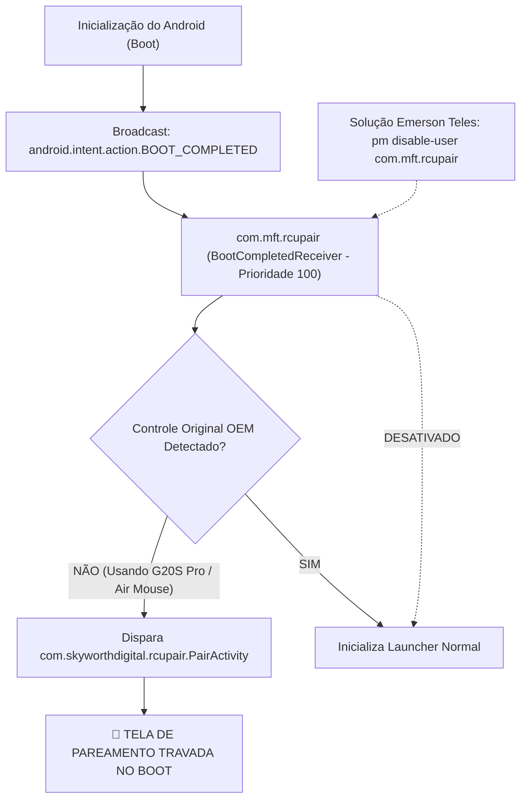

# 📺 Android TV Remote Pairing Fix — Desbloqueador e Corretor Definitivo

<p align="center">
  <b>🇧🇷 Português</b> | <a href="README.en.md">🇺🇸 English</a>
</p>

<p align="center">
  <a href="https://github.com/Emertels/AndroidTV-Remote-Pairing-Fix/releases"></a>
  <a href="https://android.com"></a>
  <a href="https://microsoft.com/windows"></a>
  
  <a href="LICENSE"></a>
</p>

Utilitário portátil e inteligente desenvolvido por **Emerson Teles** (com assistência técnica do **Gemini**) para solucionar de forma definitiva o problema de travamento na tela de pareamento forçado de controle remoto (`com.mft.rcupair`) e fornecer otimização total para TV Sticks e TV Boxes (Mecool, Mibro, Skyworth e compatíveis rodando Android 11, 12 e 14 / Google TV).

---

## 📋 Sumário

1. [O Problema Crônico](#-o-problema-crônico)
2. [A Descoberta da Causa Raiz](#-a-descoberta-da-causa-raiz)
3. [As Duas Formas de Resolver](#-as-duas-formas-de-resolver)
   - [Método 1: Script Portátil 1-Clique para Windows (.BAT)](#método-1-script-portátil-1-clique-para-pc-windows)
   - [Método 2: Direto no TV Box sem Computador (via LADB)](#método-2-direto-no-tv-box-sem-computador-via-ladb)
4. [Recursos Extras e Otimizações de Sistema](#-recursos-extras-e-otimizações-de-sistema)
5. [Estrutura do Repositório](#-estrutura-do-repositório)
6. [Licença](#-licença)
7. [Sobre o Autor & Redes Oficiais](#-sobre-o-autor--redes-oficiais)

---

## 🚨 O Problema Crônico

Usuários de aparelhos TV Stick e TV Box baseados em hardware Skyworth/Amlogic (como Mecool KD3, KD5, Mibro 4K Stick e similares) frequentemente enfrentam um problema extremamente frustrante:

- Toda vez que o aparelho é ligado ou reiniciado do zero (boot completo), o sistema trava em uma tela preta exibindo uma animação pedindo para pressionar e segurar os botões **Voltar + Home** do controle remoto original de fábrica.
- Ao utilizar controles universais, Air Mouse (como **G20S Pro**, **G10**, **G20**, teclados sem fio USB ou controles Bluetooth de terceiros), **a tela simplesmente não sai**, impedindo o acesso à tela inicial.
- O usuário fica refém de pressionar teclas aleatórias insistentemente na esperança de o sistema ignorar a tela ou precisa manter o controle quebrado/original guardado.

---

## 🧠 A Descoberta da Causa Raiz

Durante uma análise de baixo nível da árvore de processos e pacotes do sistema Android 14 realizada por **Emerson Teles** com suporte analítico do **Gemini**, descobriu-se que a falha **não é problema de hardware e nem defeito do seu controle Air Mouse**:



1. **O Aplicativo Oculto de Fábrica:**  
   O firmware traz embutido na partição de sistema o pacote `/system/app/SdtRcuPair/SdtRcuPair.apk` (identificador: `com.mft.rcupair`).
2. **Receptor com Prioridade Máxima:**  
   Ele possui registrado o componente `com.skyworthdigital.rcupair.receiver.BootCompletedReceiver` escutando o evento `BOOT_COMPLETED` com prioridade **100**.
3. **Bloqueio de Controles Genéricos:**  
   O aplicativo verifica exclusivamente o identificador Bluetooth de fábrica da OEM. Quando detecta que você está usando um controle alternativo (mesmo conectado por Bluetooth ou dongle USB), ele assume erroneamente que o dispositivo está "sem controle" e força a abertura da atividade `PairActivity`.
4. **Persistência Irritante:**  
   Como o pacote é nativo do sistema operacional, as configurações convencionais do Google TV não oferecem nenhuma opção para desinstalá-lo ou desativá-lo pela interface visual.

---

## 🛠️ As Duas Formas de Resolver

Disponibilizamos duas abordagens práticas e 100% testadas para eliminar esse incômodo de forma definitiva.

### Método 1: Script Portátil 1-Clique para PC Windows

Esta é a opção mais rápida e automatizada, ideal para quem tem um computador na mesma rede Wi-Fi do TV Box.

1. Baixe o pacote pronto para uso na aba [Releases v1.0.0](https://github.com/Emertels/AndroidTV-Remote-Pairing-Fix/releases) (`AndroidTV-Remote-Pairing-Fix-v1.0.0-win64.zip`).
2. Extraia o arquivo `.zip` em qualquer pasta do seu computador.
3. Certifique-se de que a **Depuração por Wi-Fi** está ativada no seu Stick (`Configurações > Opções do desenvolvedor > Depuração por Wi-Fi`).
4. Execute o arquivo **`Corrigir_Controle_Stick.bat`** com dois cliques.
5. Digite o endereço IP do seu Stick quando solicitado (ex: `192.168.1.14`).
6. Escolha a **Opção [1]** para desativar a tela do controle em 1 segundo, ou a **Opção [2]** para otimização completa (desativação do launcher pesado, remoção de bloatwares e sincronização HDMI-CEC).

---

### Método 2: Direto no TV Box sem Computador (via LADB)

Se você não tiver um computador por perto, é possível desativar o pacote diretamente de dentro do próprio TV Box usando o aplicativo **LADB (Local ADB)**:

1. **Baixar o LADB:** Instale o aplicativo **LADB — Local ADB Shell** no seu Stick (via Play Store ou baixando o APK).
2. **Ativar Opções do Desenvolvedor:**
   - Vá em `Configurações > Sistema > Sobre > Número da versão (Build)` e clique 7 vezes no botão OK até aparecer a mensagem *"Você agora é um desenvolvedor"*.
3. **Parear o LADB com o Sistema:**
   - Abra o LADB na TV. Ele solicitará a **Porta** e o **Código de Pareamento**.
   - Coloque o LADB em tela dividida (ou abra em janela sobreposta) e acesse `Configurações > Opções do desenvolvedor > Depuração por Wi-Fi > Parear dispositivo com código de pareamento`.
   - Digite o código de 6 dígitos e a porta de pareamento no LADB e clique em **Pair**.
4. **Executar o Comando:**
   - No terminal do LADB dentro da TV, cole e execute o comando:
     ```bash
     pm disable-user --user 0 com.mft.rcupair
     ```
5. Pronto! Ao receber a resposta `Package com.mft.rcupair new state: disabled-user`, a tela estará permanentemente extinta.

---

## ⚡ Recursos Extras e Otimizações de Sistema

Além da correção do controle, este repositório documenta e automatiza as melhores práticas para deixar seu TV Stick leve e rápido:

* **Projectivy Launcher como Padrão Nativo:**  
  Desativação do launcher pesado com propagandas da Google TV (`launcherx`) e de seu fallback (`setupwraith`), garantindo abertura instantânea do Projectivy ao pressionar a tecla Home.
* **Remoção de Bloatwares de Streaming:**  
  Desinstalação de pacotes pesados pré-instalados de fábrica (Netflix, Prime Video, YouTube, YouTube Music, Google Play Games).
* **Sincronização Total HDMI-CEC:**  
  Ativação das flags globais do sistema (`hdmi_control_auto_wakeup_enabled = 1`) para ligar e desligar o aparelho em conjunto com a televisão (especialmente TVs Sony Bravia Sync).

---

## 📂 Estrutura do Repositório

```text
AndroidTV-Remote-Pairing-Fix/
├── Corrigir_Controle_Stick.bat  # Script interativo 1-clique com menu em português
├── README.md                    # Documentação principal em Português
├── README.en.md                 # Full documentation in English
├── MANUAL.md                    # Manual passo a passo detalhado (PC e LADB)
├── MANUAL.en.md                 # Comprehensive step-by-step User Manual (EN)
├── AGENTS.md                    # Diretrizes técnicas para IA e desenvolvedores
├── CHANGELOG.md                 # Registro histórico de alterações
└── LICENSE                      # Licença de código aberto MIT
```

---

## 📄 Licença

Distribuído sob a licença **MIT**. Consulte o arquivo [LICENSE](LICENSE) para mais detalhes.

---

## 👨‍💻 Sobre o Autor & Redes Oficiais

Desenvolvido e mantido por **Emerson Teles** (conhecido na comunidade como **Emertels**).

Entusiasta de tecnologia, informática, eletrônica, jogos, manutenção avançada de sistemas e tradução/localização técnica de softwares para Português do Brasil (PT-BR). Desenvolvedor focado em utilitários práticos, ferramentas de produtividade, automação inteligente e correções de sistema para a comunidade.

### 🌐 Conecte-se comigo & Comunidades Oficiais

<div align="left">

[](https://github.com/emertels)
[](https://emertels.github.io)
[](https://emertels.github.io/discord)
[](https://x.com/emertels)
[](https://www.youtube.com/@emersonteles2379)
[](https://t.me/apksmodsandroid)
[](https://ko-fi.com/emertels)

</div>
